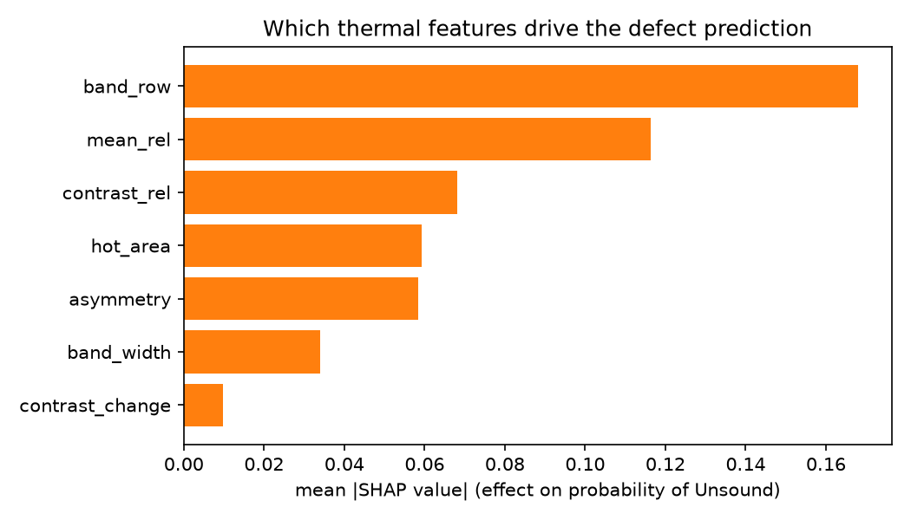
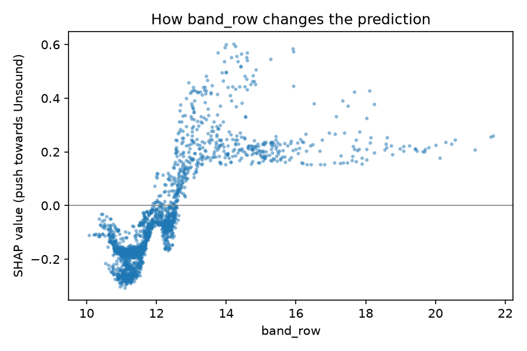

# Laser Weld Defect Inspection with Machine Learning

**Status: in active development (phases 0–6 of 10 complete).** This README is updated as each phase is finished. Results are only reported once they exist.

## Goal
Detect when a laser beam weld turns from **sound** to **unsound** (a discontinuity forms as the metal sheets move apart), using in-process sensor data from real welding experiments, and explain which physical signals drive the prediction.

## Data
Real laboratory data: 100 recorded laser butt welds at two welding speeds (1 m/min and 5 m/min).
- **Long-wave infrared (LWIR) camera**: 32 × 32 px thermal frames at 30 Hz, labelled per frame as *Sound*, *Unsound* or *Beginning* (97 welds; 10,884 sound and 5,486 unsound frames).
- **Inductive probes**: three displacement sensors (mm) at 1,000 Hz tracking sheet movement.

Source: Walther D. et al. (2025), *Dataset for weld seam analysis and discontinuity prediction in laser beam welding scenarios*, Data in Brief. [doi:10.6084/m9.figshare.27877413.v1](https://doi.org/10.6084/m9.figshare.27877413.v1), licence CC BY 4.0. The data is not stored in this repository; the download script fetches and checks it.

## Data validation findings (phase 1)
- **16,362 labelled frames** from 97 welds: 10,877 Sound and 5,485 Unsound (12,959 at 1 m/min, 3,403 at 5 m/min).
- **Two camera scales:** 29 welds (the earliest recordings, weld numbers 000–014) store pixel values around 11,000–40,000; the other 68 are around 420–460. No weld mixes both, so features will be normalised per weld rather than mixing units.
- **Missing images:** weld 002-048 has 8 labelled frames (77–84) without an image file; they are excluded, not filled in.
- **Time-order risk:** in 93 of 97 welds the labels run Beginning → Sound → Unsound, so a model could learn "late in the weld" instead of the thermal signal. Phase 4 tests for this explicitly.

## Exploratory findings (phase 2)
Full analysis: [notebooks/01_exploratory_analysis.ipynb](notebooks/01_exploratory_analysis.ipynb)


- **Sound** frames show a sharp, hot band along the seam; **unsound** frames become cooler and more uniform.
- Per weld, unsound frames sit about one standard deviation lower in mean, maximum and spread than sound frames, so simple thermal features already separate the classes.
- The first unsound frames can still look sound, and the temperature drop can lag the label, so errors are expected right at the transition.


- **Leakage risk:** unsound frames almost always occur in the last third of a weld. A model could learn *time* instead of *heat*, so phase 4 compares against a position-only baseline and splits data by weld.


## Features (phase 3)
Seven features per frame, computed **without labels and without future frames** (each weld is compared only with its own first 0.5 s):

| Feature | Physical meaning | Median Sound | Median Unsound |
|---|---|---|---|
| `contrast_rel` | Hot-spot strength relative to the weld start | 1.10 | 0.68 |
| `mean_rel` | Overall heat relative to the weld start | 0.04 | −0.20 |
| `hot_area` | Share of pixels above half maximum (hot-band size) | 0.18 | 0.15 |
| `band_width` | Vertical width of the hot band (FWHM, px) | 6 | 5 |
| `band_row` | Vertical position of the hot band (px) | 11.4 | 13.1 |
| `asymmetry` | Left–right heat difference along the seam | −0.02 | −0.00 |
| `contrast_change` | Change in contrast since the previous frame | −0.002 | −0.009 |

Shape features are scale-free and the intensity features are relative to each weld's baseline, so the two camera scales no longer matter (verified by tests).

## Baseline results (phase 4)
Logistic regression, 5-fold cross-validation **split by weld** (no weld in both training and test), mean ± std over folds:

| Model | ROC AUC | Balanced accuracy | F1 (unsound) |
|---|---|---|---|
| Position in weld only (uses the future: cheating baseline) | 0.976 ± 0.011 | 0.918 ± 0.016 | 0.877 ± 0.033 |
| **Thermal features only (deployable)** | **0.948 ± 0.010** | **0.900 ± 0.006** | **0.862 ± 0.020** |
| Thermal features + position | 0.987 ± 0.006 | 0.953 ± 0.011 | 0.933 ± 0.023 |

**Honest reading:** in this dataset the label is strongly tied to time, so "position in the weld" alone scores very high. But position needs to know when the weld ends, which is not available while welding. The thermal model uses only the current and earlier frames and still reaches 0.95 ROC AUC, so the thermal signal is real. Phase 5 tests whether a non-linear model closes the gap.

## Random Forest results (phase 5)
Thermal features only, nested cross-validation split by weld (outer 5 folds for testing; the decision threshold is chosen on the training welds only):

| Metric | Logistic regression (phase 4) | **Random Forest** | Position-only baseline |
|---|---|---|---|
| ROC AUC | 0.948 ± 0.010 | **0.974 ± 0.007** | 0.976 ± 0.011 |
| Balanced accuracy | 0.900 ± 0.006 | **0.927 ± 0.012** | 0.918 ± 0.016 |
| F1 (unsound) | 0.862 ± 0.020 | **0.900 ± 0.016** | 0.877 ± 0.033 |

Confusion matrix over all test welds: 4,987 of 5,485 unsound frames detected (91%), 614 of 10,877 sound frames falsely flagged (5.6%).

The non-linear model, using only current and past thermal information, now matches the position-only baseline in ranking (ROC AUC) and beats it in balanced accuracy and F1, without knowing when the weld ends.

## What drives the predictions (phase 6)
SHAP values for 2,000 random frames explain the Random Forest's probability of "Unsound" (`python -m laser_defect.explain`):



| Feature | Mean \|SHAP\| | Reading |
|---|---|---|
| `band_row` | 0.168 | Hot band sitting **lower** in the image → Unsound |
| `mean_rel` | 0.116 | **Cooler** frame than at the weld start → Unsound |
| `contrast_rel` | 0.068 | **Weaker** hot spot → Unsound |
| `hot_area` | 0.059 | **Smaller** hot area → Unsound |
| `asymmetry` | 0.058 | More heat on the left half → Unsound |
| `band_width` | 0.034 | **Narrower** hot band → Unsound |
| `contrast_change` | 0.010 | Small effect |

The model relies on physically meaningful signals (less heat, weaker and smaller melt zone). The strongest feature, the vertical position of the hot band, needs care: it may reflect a real shift of the melt zone, but it could also drift with time in the weld, so it is a candidate for a leakage check.



## Plan
| Phase | Content | Status |
|---|---|---|
| 0 | Project setup, data download with integrity check, first tests | Done |
| 1 | Load and validate thermal frames and labels | Done |
| 2 | Exploratory analysis notebook | Done |
| 3 | Physics-motivated features from thermal frames | Done |
| 4 | Baseline model, split by weld to avoid leakage | Done |
| 5 | Random Forest, cross-validation, threshold choice | Done |
| 6 | Model explanation with SHAP | Done |
| 7 | Test suite for data, features and pipeline | Next |
| 8 | Streamlit dashboard | Planned |
| 9 | Final results, reproducibility, limitations | Planned |

## Run it
```bash
pip install -e .
python -m laser_defect.download   # downloads ~90 MB into data/ and checks its size
python -m laser_defect.data       # loads, checks and saves all labelled thermal frames
python -m laser_defect.explore    # re-creates all figures in reports/figures/
python -m laser_defect.features   # computes 7 features per frame -> data/processed/features.csv
python -m laser_defect.train      # weld-based cross-validation of the baseline models
python -m laser_defect.model      # Random Forest, nested CV, saves models/defect_classifier.joblib
pytest -v
```

## Author
Deep Punj, PhD: optical engineer and physicist moving into data science. [LinkedIn](https://linkedin.com/in/deeppunj)
