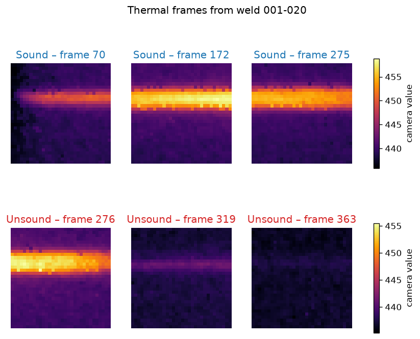
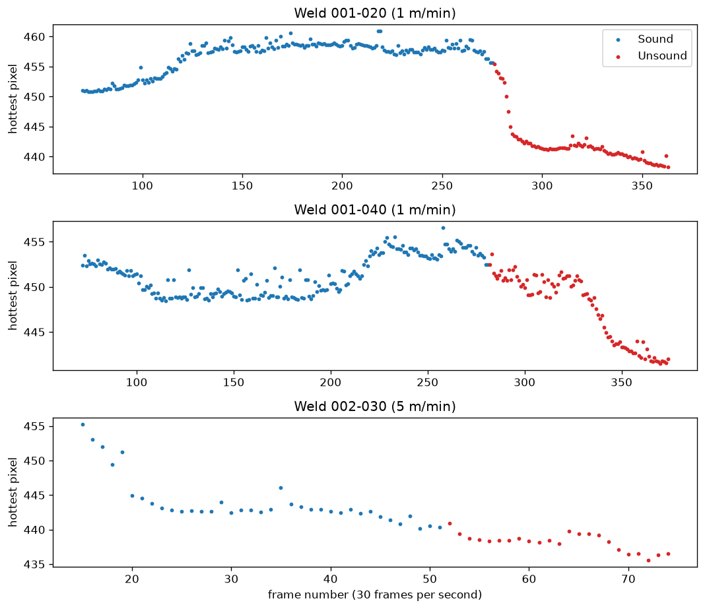
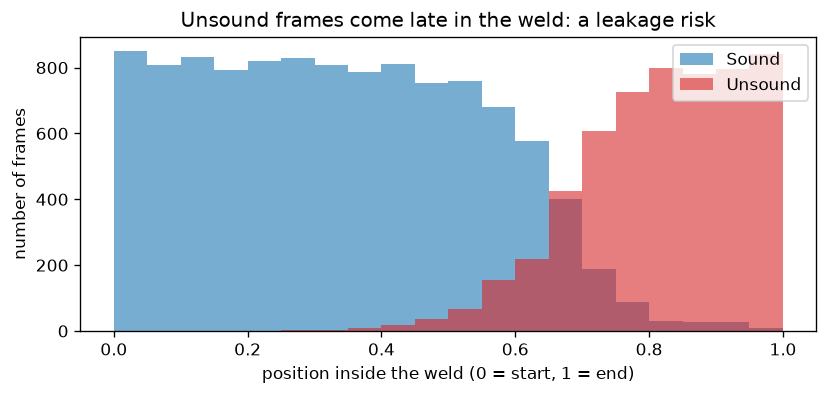

# Laser Weld Defect Inspection with Machine Learning

**Status: in active development (phases 0–3 of 10 complete).** This README is updated as each phase is finished. Results are only reported once they exist.

## Goal
Detect when a laser beam weld turns from **sound** to **unsound** (a discontinuity forms as the metal sheets move apart), using in-process sensor data from real welding experiments, and explain which physical signals drive the prediction.

## Data
Real laboratory data: 100 recorded laser butt welds at two welding speeds (1 m/min and 5 m/min).
- **Long-wave infrared (LWIR) camera**: 32 × 32 px thermal frames at 30 Hz, labelled per frame as *Sound*, *Unsound* or *Beginning* (97 welds; 10,884 sound and 5,486 unsound frames).
- **Inductive probes**: three displacement sensors (mm) at 1,000 Hz tracking sheet movement.

Source: Walther D. et al. (2025), *Dataset for weld seam analysis and discontinuity prediction in laser beam welding scenarios*, Data in Brief. [doi:10.6084/m9.figshare.27877413.v1](https://doi.org/10.6084/m9.figshare.27877413.v1), licence CC BY 4.0. The data is not stored in this repository; the download script fetches and checks it.

## Data validation findings (phase 1)
- **16,362 labelled frames** from 97 welds: 10,877 Sound and 5,485 Unsound (12,959 at 1 m/min, 3,403 at 5 m/min).
- **Two camera scales:** 29 welds (the earliest recordings, weld numbers 000–014) store pixel values around 11,000–40,000; the other 68 are around 420–460. No weld mixes both, so features will be normalised per weld rather than mixing units.
- **Missing images:** weld 002-048 has 8 labelled frames (77–84) without an image file; they are excluded, not filled in.
- **Time-order risk:** in 93 of 97 welds the labels run Beginning → Sound → Unsound, so a model could learn "late in the weld" instead of the thermal signal. Phase 4 tests for this explicitly.

## Exploratory findings (phase 2)
Full analysis: [notebooks/01_exploratory_analysis.ipynb](notebooks/01_exploratory_analysis.ipynb)



- **Sound** frames show a sharp, hot band along the seam; **unsound** frames become cooler and more uniform.
- Per weld, unsound frames sit about one standard deviation lower in mean, maximum and spread than sound frames, so simple thermal features already separate the classes.
- The first unsound frames can still look sound, and the temperature drop can lag the label, so errors are expected right at the transition.



- **Leakage risk:** unsound frames almost always occur in the last third of a weld. A model could learn *time* instead of *heat*, so phase 4 compares against a position-only baseline and splits data by weld.



## Features (phase 3)
Seven features per frame, computed **without labels and without future frames** (each weld is compared only with its own first 0.5 s):

| Feature | Physical meaning | Median Sound | Median Unsound |
|---|---|---|---|
| `contrast_rel` | Hot-spot strength relative to the weld start | 1.10 | 0.68 |
| `mean_rel` | Overall heat relative to the weld start | 0.04 | −0.20 |
| `hot_area` | Share of pixels above half maximum (hot-band size) | 0.18 | 0.15 |
| `band_width` | Vertical width of the hot band (FWHM, px) | 6 | 5 |
| `band_row` | Vertical position of the hot band (px) | 11.4 | 13.1 |
| `asymmetry` | Left–right heat difference along the seam | −0.02 | −0.00 |
| `contrast_change` | Change in contrast since the previous frame | −0.002 | −0.009 |

Shape features are scale-free and the intensity features are relative to each weld's baseline, so the two camera scales no longer matter (verified by tests).

## Plan
| Phase | Content | Status |
|---|---|---|
| 0 | Project setup, data download with integrity check, first tests | Done |
| 1 | Load and validate thermal frames and labels | Done |
| 2 | Exploratory analysis notebook | Done |
| 3 | Physics-motivated features from thermal frames | Done |
| 4 | Baseline model, split by weld to avoid leakage | Next |
| 5 | Random Forest, cross-validation, threshold choice | Planned |
| 6 | Model explanation with SHAP | Planned |
| 7 | Test suite for data, features and pipeline | Planned |
| 8 | Streamlit dashboard | Planned |
| 9 | Final results, reproducibility, limitations | Planned |

## Run it
```bash
pip install -e .
python -m laser_defect.download   # downloads ~90 MB into data/ and checks its size
python -m laser_defect.data       # loads, checks and saves all labelled thermal frames
python -m laser_defect.explore    # re-creates all figures in reports/figures/
python -m laser_defect.features   # computes 7 features per frame -> data/processed/features.csv
pytest -v
```

## Author
Deep Punj, PhD: optical engineer and physicist moving into data science. [LinkedIn](https://linkedin.com/in/deeppunj)
